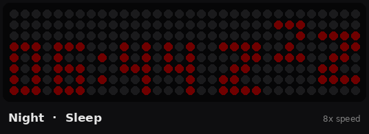

# Children's Clock

An ESPHome-based "ok-to-wake" clock for kids, built on a 32×8 WS2812B LED matrix. The color tells a child what to do at a glance: red means stay in bed, amber means almost time, green means it's OK to get up. It also handles bedtime wind-down, naps, weekends and holidays, and reports room temperature and humidity to Home Assistant.

This is a fork of [chrisns/childrens-clock](https://github.com/chrisns/childrens-clock), reworked with a new schedule engine, perceptual brightness control, animations and a dedicated night view.



## Features

- **Five states**: Sleep (red), Waking up (amber), Awake (green), Wind down (amber) and Nap (purple).
- **Separate schoolday and weekend schedules**, plus a Holiday Mode that treats every day as a weekend.
- **Optional daytime nap** with its own start and end time.
- **Bedtime wind-down**: for the last 30 minutes before bed the display blends smoothly from green to amber.
- **Countdown cues**: the colon blinks slowly in the last 10 minutes of an amber period and quickly in the last 5.
- **Progress bar** along the top row that shrinks as the current period runs out.
- **Night view**: during sleep and naps the big clock is replaced by a small time and a "Zzz" icon, kept very dim.
- **Transition animations**: a sun sets, rises or slips behind a horizon when the state changes.
- **Day and night brightness** as simple 0–100% sliders, with perceptual gamma so low values stay usable.
- **Temperature and humidity** from a DHT22 sensor.
- **Fail-safes**: a blinking red border when there is no valid time, and a dashed progress bar when the schedule doesn't make sense.

## Hardware

| Part | Notes |
| --- | --- |
| ESP32 CH340C, USB-C (ESP32-DevKit style) | Any ESP32 dev board should work; see the chip revision note below |
| WS2812B 8×32 RGB LED matrix | 256 LEDs, serpentine column wiring |
| DHT22 temperature/humidity sensor | A module with a built-in pull-up resistor is easiest |
| 3D-printed case | [32 × 8 WS2812B LED Matrix Case on MakerWorld](https://makerworld.com/en/models/1948396-32-x-8-ws2812b-led-matrix-case#profileId-2093378) |
| 5V power supply | See the power note below |

### Wiring

| From | To |
| --- | --- |
| Matrix DIN | ESP32 GPIO13 |
| Matrix 5V / GND | 5V supply / GND |
| DHT22 data | ESP32 GPIO4 |
| DHT22 VCC / GND | ESP32 3.3V / GND |

Make sure the matrix, ESP32 and supply share a common ground.

### Power

At the default brightness settings (25% day, 1% night) the matrix draws very little and the clock runs fine from USB. Pushing day brightness to 100% lights every pixel at full green, which can draw around 5A. That is far more than USB through the dev board can deliver, so either keep brightness moderate or power the matrix from a suitably rated 5V supply.

### Chip revision

The config sets `minimum_chip_revision: "3.1"`. Firmware built this way will not boot on older ESP32 silicon. If your board bootloops after flashing, check the chip revision in the serial log and lower or remove this setting.

## Installation

### 1. Files

Place the files in your ESPHome config directory like this:

```
esphome/
├── children_clock_base.yaml
├── childrens-clock.yaml      # your device file (see below)
├── lexis.ttf                 # pixel font used for the clock digits
├── secrets.yaml
└── src/
    └── childrensclock.h
```

### 2. Secrets

Add these to `secrets.yaml`:

```yaml
wifi_ssid: "your-network"
wifi_password: "your-password"
api_encryption_key: "generate-one-with-esphome"
```

### 3. Device file

Create a small device file that sets the substitutions and pulls in the base config:

```yaml
substitutions:
  device_name: childrens-clock
  friendly_name: Children's Clock
  temp_offset: "-2.0"      # correct for heat from the case and LEDs
  humidity_offset: "0"

packages:
  base: !include children_clock_base.yaml
```

### 4. Flash

Flash over USB the first time with `esphome run childrens-clock.yaml`. After that, updates can go over the air. The device is then discovered by Home Assistant through the ESPHome integration.

### Timezone

The timezone is set to `Europe/Amsterdam` in both `time:` sources in `children_clock_base.yaml`. Change both if you live elsewhere.

## How the schedule works

Each "clock day" runs from one morning's wake-up time to the next morning's wake-up time:

| Period | State | Color |
| --- | --- | --- |
| Wake up → Go | Waking up | Amber |
| Go → 30 min before bedtime | Awake (or Nap, if enabled) | Green (purple during nap) |
| Last 30 min before bedtime | Wind down | Green fading to amber |
| Bedtime → next Wake up | Sleep | Red |

**Weekend days** (Saturday and Sunday) use the weekend Wake up and Go times. **Weekend nights** (Friday and Saturday) use the weekend Bedtime, so Friday evening can be later than other school nights. **Holiday Mode** treats every day and night as a weekend.

Bedtimes after midnight are supported.

### Schedule validation

For every day of the week, the times must satisfy:

```
wake < go < (bedtime − 30 min) < bedtime < next morning's wake
```

If the nap is enabled, it must start after Go and end before the wind-down starts. If any day breaks these rules, the clock shows a dashed progress bar, reports "Invalid schedule" and skips animations until the times are fixed. This means you can safely edit times one at a time without triggering a stray sunset.

### Default times

| Setting | Default |
| --- | --- |
| Schoolday Wake up / Go / Bedtime | 06:45 / 07:00 / 19:00 |
| Weekend Wake up / Go / Bedtime | 07:00 / 07:15 / 19:00 |
| Nap Start / End | 12:30 / 15:00 (disabled by default) |

## The display

**Daytime and amber periods** show the time in large digits. The top row is a progress bar that shrinks as the current period runs out, with a partially lit final pixel for smooth movement.

**Sleep and nap** switch to the night view: a small HH:MM on the left, a "Zzz" icon on the right and a dimmed progress bar, all at night brightness.

**Animations** play for 20 seconds when the state changes:

| Transition | Animation |
| --- | --- |
| Awake or Wind down → Sleep | Sunset |
| Sleep → Waking up | Sunrise |
| Waking up → Awake | Sun rises off the top |
| Awake → Nap | Nap start |
| Nap → Awake | Nap end |

**No time available** (for example right after boot with no network) shows a dim blinking red border.

### Brightness

Brightness Day controls green, Brightness Night controls red and the nap purple, and amber sits halfway between them. Both sliders use a 2.2 perceptual gamma curve, so 1% is the dimmest possible glow rather than off, and 0% turns that state off entirely. Gamma is applied in `childrensclock.h` rather than by ESPHome, so all three color channels scale together and amber stays amber at low levels.

## Home Assistant entities

| Entity | Type | Purpose |
| --- | --- | --- |
| Clock State | Text sensor | Sleep, Waking up, Awake, Wind down, Nap, Invalid schedule or No time |
| Clock Schedule Valid | Binary sensor | Whether the current schedule passes validation |
| Schoolday / Weekend Wake up, Go, Bedtime | Time | The schedule |
| Nap Start, Nap End | Time | Nap window |
| Nap Enabled | Switch | Turns the nap on or off |
| Holiday Mode | Switch | Treats every day as a weekend |
| Brightness Day, Brightness Night | Number | 0–100% |
| Room Temperature, Room Humidity | Sensor | From the DHT22 |
| Test Sunset / Sunrise / Nap Start / Nap End / Day Start Animation | Button (diagnostic) | Preview animations |
| Color Test Active, Color Test Red / Green / Blue | Switch, Number (diagnostic) | Fill the matrix with a raw RGB color |
| Restart, Safe Mode Reboot, Factory Reset | Button | Maintenance |

## Customizing

- **Matrix orientation**: if your matrix is wired differently, adjust `pixel_mapper` or `rotation` in the `display:` section.
- **Colors**: the hues are defined at the top of `childrensclock.h` (`GREEN_HUE`, `AMBER_HUE`, `RED_HUE`, `NAP_HUE`, `HORIZON_HUE`).
- **Wind-down length**: `WIND_DOWN_MINUTES` in `childrensclock.h`.
- **Blink thresholds**: `PULSE_WARN_THRESHOLD_MIN` and `PULSE_URGENT_THRESHOLD_MIN`.
- **Animation and fade speed**: `TRANSITION_ANIM_DURATION_MS` and `FADE_TAU_MS`.

## Tips

- The DHT22 reads high inside the case because of heat from the ESP32 and LEDs. Use `temp_offset` to correct it, or mount the sensor outside the case for steadier readings.
- Use the Color Test controls to check your matrix wiring and to judge how colors look at low raw values in a dark room.

## Credits

- Original project: [chrisns/childrens-clock](https://github.com/chrisns/childrens-clock)
- Case design: [32 × 8 WS2812B LED Matrix Case](https://makerworld.com/en/models/1948396-32-x-8-ws2812b-led-matrix-case#profileId-2093378) on MakerWorld
